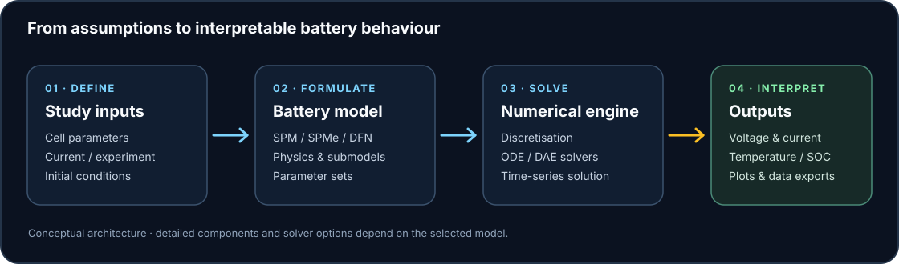

<p align="center">
  
</p>

<p align="center">
  <strong>Explore battery behaviour with physics-based models, numerical solvers, and reproducible experiments.</strong>
</p>

<p align="center">
  
  
  
  
</p>

VoltForge is a research-oriented workspace for exploring electrochemical battery simulations with Python and [PyBaMM](https://github.com/pybamm-team/PyBaMM). The included quickstart uses a lithium-ion Single Particle Model (SPM) to produce reproducible voltage data and a plot.

> **Attribution:** VoltForge is a downstream-branded project based on the PyBaMM ecosystem. The internal Python package remains `pybamm`. Upstream notices, licenses and citations must be preserved; this project is not affiliated with or endorsed by the PyBaMM team. Read [UPSTREAM_NOTICE.md](UPSTREAM_NOTICE.md) before redistribution.

## Simulation workflow

<p align="center">
  
</p>

## What is included in this repository

- A runnable lithium-ion discharge quickstart based on the SPM.
- CSV export of simulated terminal voltage.
- Optional voltage-curve plotting.
- A GitHub Actions smoke test for the quickstart.
- A custom VoltForge logo and simulation workflow diagram.
- The retained upstream BSD license notice.

**Repository sync note:** The full prepared source bundle includes the broader PyBaMM monorepo (packages, notebooks, documentation and examples). Those thousands of source files have **not yet been mirrored** into this GitHub repository; the current online version is the lightweight quickstart scaffold. The download bundle is ready locally, but a full source-tree push is still needed for the repository to contain every file.

## Quick start

Python 3.10+ is recommended.

### 1. Create and activate a virtual environment

**Windows PowerShell**

```powershell
py -3.12 -m venv .venv
.\.venv\Scripts\Activate.ps1
python -m pip install --upgrade pip
python -m pip install "pybamm[plot]"
```

**macOS / Linux**

```bash
python3 -m venv .venv
source .venv/bin/activate
python -m pip install --upgrade pip
python -m pip install "pybamm[plot]"
```

### 2. Run the example

```bash
python examples/scripts/voltforge_quickstart.py --hours 1 --samples 100
```

Outputs are saved to `outputs/voltforge_quickstart/`:

- `discharge_voltage.csv` — time in seconds/minutes and simulated terminal voltage.
- `discharge_voltage.png` — a plot of the simulated voltage curve.

Useful options:

```bash
python examples/scripts/voltforge_quickstart.py --hours 2 --samples 200 --output-dir outputs/two-hour-run
python examples/scripts/voltforge_quickstart.py --hours 1 --samples 100 --no-plot
python examples/scripts/voltforge_quickstart.py --help
```

This is a software smoke test using PyBaMM's built-in SPM and default parameter set, not a calibrated prediction for a particular commercial cell. For engineering conclusions, select appropriate parameters, validate against experimental data, and evaluate model assumptions and uncertainty.

## Repository contents currently published

```text
VoltForge/
├── .github/workflows/ci.yml
├── assets/
│   ├── architecture.svg
│   └── voltforge-logo.svg
├── examples/scripts/voltforge_quickstart.py
├── LICENSE.txt
├── UPSTREAM_NOTICE.md
├── .gitignore
└── README.md
```

The full source archive also contains PyBaMM packages, native-solver bindings, tests, docs and extensive notebooks. Since the archive came as a ZIP, it preserves `.gitmodules` but not the original SUNDIALS and SuiteSparse submodule commit pointers. A complete native source build therefore requires a proper source checkout with valid pinned submodules. The quickstart above intentionally uses the published PyBaMM distribution and does not require that native source checkout.

## Development and CI

The workflow at [`.github/workflows/ci.yml`](.github/workflows/ci.yml) installs the released PyBaMM distribution, runs the quickstart and validates the generated CSV and plot. It does not validate the full upstream source monorepo.

Generated simulation files, virtual environments and caches are excluded through [`.gitignore`](.gitignore).

## Upstream project and citation

- [PyBaMM source repository](https://github.com/pybamm-team/PyBaMM)
- [PyBaMM documentation](https://docs.pybamm.org/)
- [PyBaMM citation information](https://github.com/pybamm-team/PyBaMM#citing-pybamm)

If this work contributes to research, cite the relevant upstream work:

Sulzer, V., Marquis, S. G., Timms, R., Robinson, M., & Chapman, S. J. (2021). *Python Battery Mathematical Modelling (PyBaMM).* Journal of Open Research Software, 9(1), 14. https://doi.org/10.5334/jors.309

## License

The license notice in [`LICENSE.txt`](LICENSE.txt) is retained from the upstream PyBaMM source distribution. Individual components may carry additional notices; preserve them when importing or redistributing the full source tree.

## Safety disclaimer

Simulation outputs depend on model selection, parameter values, solver configuration and assumptions. They are not a substitute for battery safety validation or qualified engineering review.
